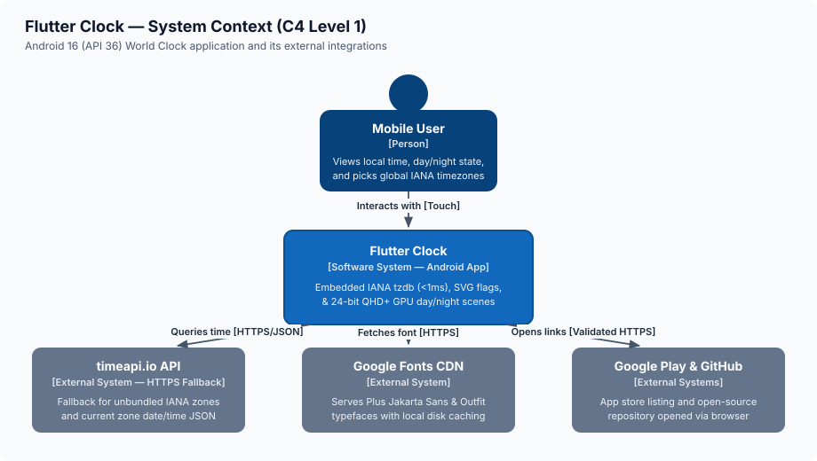
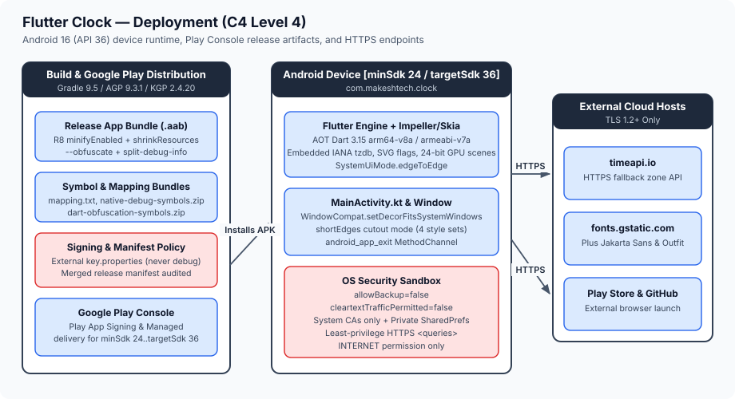

# Flutter Clock

A Simple Flutter project to display World Clocks dynamically from WorldTimeAPI.

## Features

- **Live World Clock**: Displays the current time (`Aladin` display typography), date, location name, and circular country flag for the selected timezone.
- **Dynamic Day/Night Backgrounds**: Automatically switches between day and night animated backgrounds based on local hour (`7:00 AM`–`6:59 PM` day, otherwise night).
- **Pull-to-Refresh & Auto-Sync**: Pull down on the home screen to refresh immediately, with minute-aligned background resynchronization.
- **Timezone Picker & Fuzzy Search**: Browse all available IANA timezones with country flags and search instantaneously (`2+` characters, debounce + fuzzy/token matching).
- **Persistent Selection**: Saves your last chosen timezone locally and migrates legacy preferences seamlessly across updates.
- **Overflow Menu**: `Change Location`, `Play Store`, `GitHub`, `About`, and `Exit`.

## Architecture

Flutter Clock follows **Feature-First Clean Architecture** under `lib/src/` (`core/`, `app/`, `features/clock/`, `features/locations/`), with strict isolation of pure-Dart `domain/` layers from Flutter UI and platform plugins, reactive `ChangeNotifier` + `Provider` state management, and native Dart 3 replacements for legacy UI packages.

### System Context (C4 Level 1)


### Container Diagram (C4 Level 2)


### Component Diagram (C4 Level 3)


### Deployment Diagram (C4 Level 4)


### Architecture Decision Records
- [ADR 0001: Feature-First Clean Architecture](./.docs/adr/0001-feature-first-clean-architecture.md)
- [ADR 0002: Pure-Flutter UI Replacements and `material_ui` Migration](./.docs/adr/0002-pure-flutter-replacements-for-legacy-packages.md)
- [ADR 0003: Android 16 (API 36), Edge-to-Edge, and Gradle/Kotlin Modernization](./.docs/adr/0003-android-16-edge-to-edge-and-gradle-modernization.md)
- [ADR 0004: OWASP Mobile Top 10 and Merged Release Manifest Hardening](./.docs/adr/0004-owasp-mobile-security-and-manifest-hardening.md)

## Security & Android 16 Hardening

- **Android 16 (API 36)**: `compileSdk = 36`, `targetSdk = 36`, `minSdk = 24`, full edge-to-edge rendering (`WindowCompat.setDecorFitsSystemWindows(window, false)` + `SystemUiMode.edgeToEdge`), and `shortEdges` cutout support across day/night and API 31+ styles.
- **Transport & Backup Hardening**: `cleartextTrafficPermitted="false"` with system trust anchors in `network_security_config.xml` and `android:allowBackup="false"`.
- **Input & URI Validation**: Strict IANA timezone validation, search query sanitization, flag asset path allowlisting, and external link enforcement (`https` / `market` schemes only).
- **Release Optimization & Manifest Audit**: R8 shrinking (`minifyEnabled true`, `shrinkResources true`), `FULL` native debug symbols, Dart obfuscation + split debug info, and audited release manifest stripping unwanted plugin permissions/components.

## Development & Verification

```sh
flutter pub get
flutter analyze
flutter test
flutter build apk --release
flutter build appbundle --release --obfuscate --split-debug-info=build/app/outputs/symbols
```
