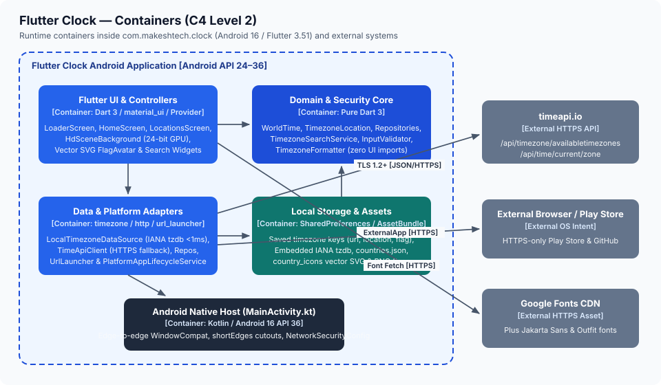
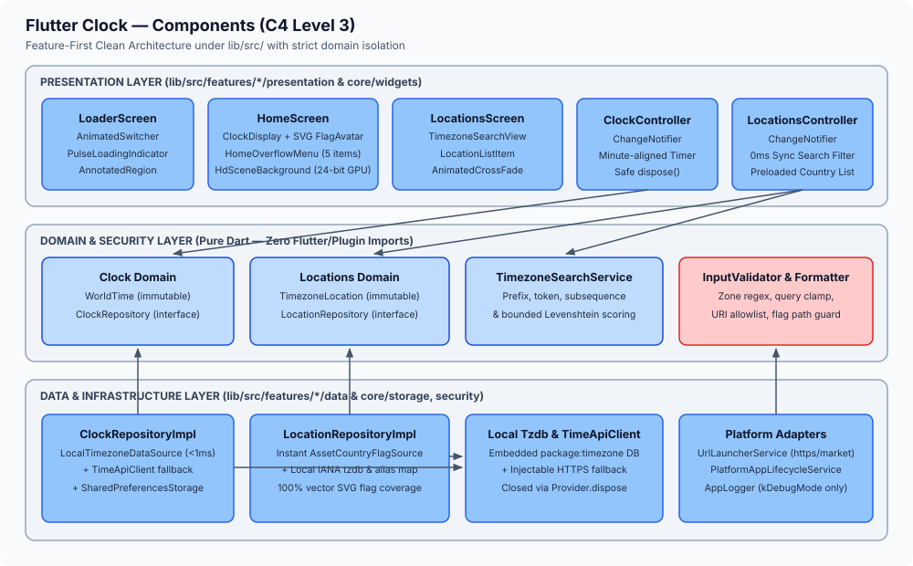

# Flutter Clock

A modern Flutter World Clock application using the embedded IANA Time Zone Database (`timezone`) with `timeapi.io` HTTPS fallback.

## Features

- **Instant IANA World Clock**: Resolves current local time, date, and DST transitions in `< 1 ms` using the bundled IANA Time Zone Database (`package:timezone/data/latest_all.dart`), with `https://timeapi.io` as an HTTPS fallback.
- **High-Contrast Typography**: Uses **`Plus Jakarta Sans`** for clean geometric UI text and **`Outfit`** (`60px`, `FontWeight.w800`, tabular numerals, 3-layer ambient + drop shadow) for bold, high-readability clock display over any background brightness.
- **24-Bit QHD+ Animated Day/Night Scenes**: Renders full-resolution 24-bit GPU `CustomPainter` scenes (`HdSceneBackground`) for daytime (*Sunset Swan Lake*) and nighttime (*Starry Crescent-Moon Mountains*) at native device pixel density without 8-bit GIF dithering or aspect-ratio cropping.
- **Vector SVG Country Flags**: Displays infinite-DPI vector SVG country flags (`flutter_svg` + `country_icons`) across all 425+ curated IANA timezones and aliases.
- **Instant Timezone Picker & Fuzzy Search**: Preloads and caches the country-backed timezone catalog at startup and filters synchronously on every keystroke (`0 ms` debounce spinner, prefix + token + bounded Levenshtein fuzzy ranking).
- **Pull-to-Refresh & Minute-Aligned Sync**: Supports manual pull-to-refresh and automatic minute-boundary resynchronization while persisting your selected timezone in `SharedPreferences`.
- **Overflow Menu**: `Change Location`, `Play Store`, `GitHub`, `About`, and `Exit`.

## Architecture

Flutter Clock follows **Feature-First Clean Architecture** under `lib/src/` (`core/`, `app/`, `features/clock/`, `features/locations/`), with strict isolation of pure-Dart `domain/` layers from Flutter UI and platform plugins, reactive `ChangeNotifier` + `Provider` state management, and native Dart 3 UI components.

### System Context (C4 Level 1)


### Container Diagram (C4 Level 2)


### Component Diagram (C4 Level 3)


### Deployment Diagram (C4 Level 4)


### Architecture Decision Records
- [ADR 0001: Feature-First Clean Architecture](./.docs/adr/0001-feature-first-clean-architecture.md)
- [ADR 0002: Pure-Flutter UI Replacements, Local IANA Timezone Engine, and `material_ui` Migration](./.docs/adr/0002-pure-flutter-replacements-for-legacy-packages.md)
- [ADR 0003: Android 16 (API 36), Edge-to-Edge, and Gradle/Kotlin Modernization](./.docs/adr/0003-android-16-edge-to-edge-and-gradle-modernization.md)
- [ADR 0004: OWASP Mobile Top 10 and Merged Release Manifest Hardening](./.docs/adr/0004-owasp-mobile-security-and-manifest-hardening.md)

## Security & Android 16 Hardening

- **Android 16 (API 36)**: `compileSdk = 36`, `targetSdk = 36`, `minSdk = 24`, full edge-to-edge rendering (`WindowCompat.setDecorFitsSystemWindows(window, false)` + `SystemUiMode.edgeToEdge`), and `shortEdges` cutout support across day/night and API 31+ styles.
- **Transport & Backup Hardening**: `cleartextTrafficPermitted="false"` with system trust anchors in `network_security_config.xml` and `android:allowBackup="false"`.
- **Input & URI Validation**: Strict IANA timezone validation, search query sanitization, SVG/PNG flag asset path allowlisting, and external link enforcement (`https` with no userInfo / `market` schemes only).
- **Release Optimization & Manifest Audit**: R8 shrinking (`minifyEnabled = true`, `shrinkResources = true`), `FULL` native debug symbols, Dart obfuscation + split debug info, and audited release manifest stripping unused `WebViewActivity`.

## Development & Verification

```sh
flutter pub get
flutter analyze
flutter test
flutter build apk --release
flutter build appbundle --release --obfuscate --split-debug-info=build/app/outputs/symbols
```
